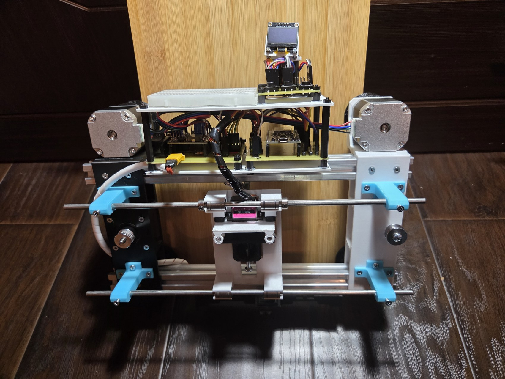
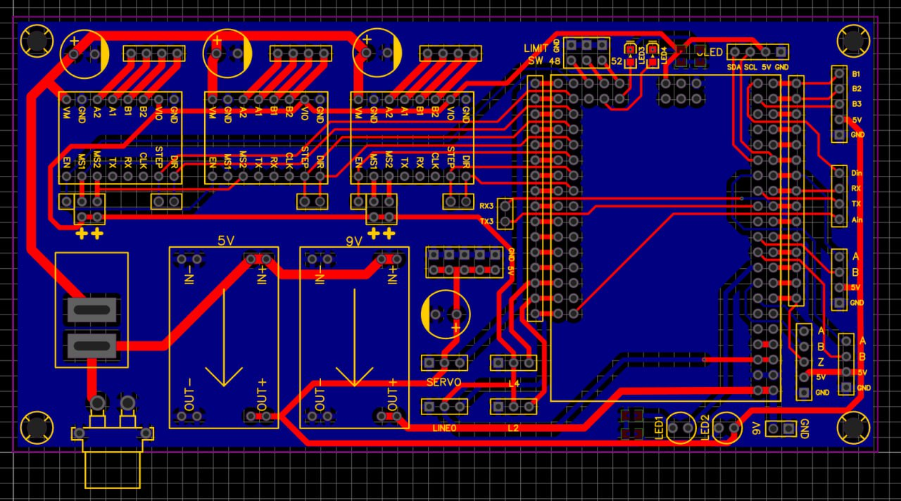

# Вертикальный робот-плоттер

Робот самостоятельно перемещается по двум зубчатым рейкам на вертикальном полигоне и рисует маркером на листе. Разработан для проектного тура ВсОШ по информатике, профиль «Робототехника», 11 класс, сезон 2025/26.

.jpg)

## Как устроен робот

- **Механика.** Два шаговых двигателя NEMA 17 синхронно поднимают и опускают раму вдоль боковых реек (ось X). Третий перемещает каретку поперёк листа (ось Y). Сервопривод MG90S подводит маркер к бумаге и отводит его перед холостым ходом.
- **Электроника.** В двухосевой версии Arduino Mega 2560 Pro управляет тремя драйверами TMC2226. На каретке установлен датчик отражения. Режим выбирается кнопками через OLED-дисплей.
- **Прошивка.** Робот находит начало координат по чёрной разметке и строит контуры фигур по заданным точкам. Линейная интерполяция синхронизирует шаги двигателей по осям X и Y, чтобы маркер двигался по прямой между точками.

## Тест заключительного этапа

Режим `test1` находит разметку, переводит маркер к началу траектории и проводит два перпендикулярных отрезка по 150 мм. Затем робот поднимает маркер, снова привязывается к разметке и возвращается в зону старта. Во время выполнения включён светодиод. В репозитории лежит скетч этого теста с сервисными режимами. [Единое техническое задание](https://robot.mipt.ru/downloads/etz_re.pdf)

## Материалы

| Что посмотреть | Файлы |
| --- | --- |
| Прошивка заключительного этапа | [Скетч Arduino](firmware/code_etz_zakl_2/code_etz_zakl_2.ino) · [Движение и калибровка](firmware/code_etz_zakl_2/movement.h) |
| Механика | [Общая сборка STEP](cad/assembly.step) · [Отдельные детали](cad/parts) |
| Электроника заключительного этапа | [Структурная схема Э1](hardware/E1-block-diagram.pdf) · [Принципиальная схема Э3](hardware/E3-schematic.pdf) |
| Фотографии прототипа | [Общий вид](photos/perspective.jpg) · [Вид сверху](photos/top.jpg) · [Вид со стороны ходовой части](photos/underside.jpg) |
| Ранняя версия на ESP32 | [Скетч ESP32](firmware/new_code_etz/new_code_etz.ino) · [Схемы](hardware/esp32) |
